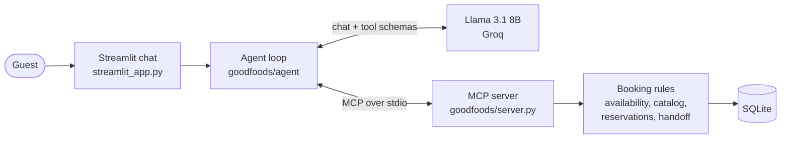

# GoodFoods Reservation Agent

[](https://github.com/Ansh-66/goodfoods-agent/actions/workflows/ci.yml)

A conversational agent that books tables across the 75 outlets of GoodFoods, a Bengaluru restaurant chain. Guests describe what they want in plain language; the agent recommends outlets, checks live availability, and books, changes or cancels reservations through tools served over MCP. When an outlet is full, it routes the guest to another time or a nearby GoodFoods outlet instead of losing the booking.

- **Model:** Llama 3.1 8B (`llama-3.1-8b-instant`) on Groq, temperature 0
- **Protocol:** Model Context Protocol; the tools run in an MCP server, the agent is an MCP client
- **Agent:** written from scratch, with no agent framework
- **Evaluation:** 13 scripted guest journeys measuring tool selection, argument accuracy and outcomes

## Demo

PENDING: demo video link.

## Contents

- [Quick start](#quick-start)
- [Architecture](#architecture)
- [How the agent works](#how-the-agent-works)
- [Prompt engineering](#prompt-engineering)
- [Evaluation](#evaluation)
- [Example conversations](#example-conversations)
- [Business strategy](#business-strategy)
- [Assumptions, limitations and future work](#assumptions-limitations-and-future-work)
- [Project layout](#project-layout)

## Quick start

You need a free Groq API key from [console.groq.com](https://console.groq.com/keys).

**Docker**

```bash
docker build -t goodfoods-agent .
docker run --rm -p 8501:8501 -e GROQ_API_KEY=your_key goodfoods-agent
```

Open http://localhost:8501. The container seeds the demo database on start.

**Local (Python 3.10+)**

```bash
python -m venv .venv
source .venv/bin/activate          # Windows: .venv\Scripts\Activate.ps1
pip install -e ".[dev]"
cp .env.example .env               # then set GROQ_API_KEY
python -m goodfoods.setup_db       # build data/goodfoods.db
streamlit run streamlit_app.py
```

**Checks**

```bash
pytest                             # 37 tests, no API key needed (the model is scripted)
ruff check . && ruff format --check .
python evals/run_eval.py           # live evaluation against Groq, about 20 minutes on the free tier
```

**Try these** (the demo data makes some outlets full at dinner):

- "Dinner for 4 this Friday at 8 pm, somewhere Italian near Koramangala"
- "Is GoodFoods Green Bowl in Koramangala free on Friday at 8 pm for 4?" (full: nearby outlets offered)
- "Can I get a table for 2 at Wok Street in Whitefield on Friday at 8 pm?" (full: other times offered)
- "We're 20 people for an office party next Saturday" (hand-off to staff)

## Architecture



| Layer | Responsibility |
|---|---|
| `streamlit_app.py` | Chat UI. Shows each reply with the tools it used, their arguments and results, and the model calls, tokens and time per turn. |
| `goodfoods/agent/` | The loop, the system prompt and the model wrapper. Owns conversation state and the confirmation gate. |
| `goodfoods/server.py` | Eight MCP tools. Thin wrappers that turn rule violations into readable results. |
| `goodfoods/availability.py`, `catalog.py`, `reservations.py`, `handoff.py` | Every business rule: capacity, opening hours, overflow routing, ranking, writes. No LLM and no MCP code, so all of it is unit-tested directly. |
| `goodfoods/db.py`, `setup_db.py`, `generate_data.py` | Schema, a deterministic 75-outlet catalogue (`data/restaurants.json`) and seeded demo bookings. |

**Tools**

| Tool | Purpose |
|---|---|
| `recommend_restaurants` | Rank outlets by area, cuisine, party size, price, features and occasion, with a reason each; free outlets first when a date and time are given |
| `get_restaurant_details` | Address, phone, hours, last booking time, features, policies |
| `check_availability` | Is there a table? If not, other free times at that outlet and nearby outlets free at that time |
| `make_reservation` | Book; returns a booking id |
| `get_reservation` | Look up a booking |
| `modify_reservation` | Change date, time or party size; a full slot leaves the booking unchanged and returns alternatives |
| `cancel_reservation` | Cancel |
| `request_human_handoff` | Staff ticket for complaints, groups over 12 and events |

**Capacity model.** Each outlet has a number of seats. Bookings start on 30-minute slots and hold their seats for 90 minutes; a party fits when every slot it covers has room. Availability is computed from confirmed bookings on each request, never stored. The seat check and the write run in one `BEGIN IMMEDIATE` transaction, so two guests cannot take the last table.

**Demo data.** 75 outlets across 24 Bengaluru neighbourhoods and 12 GoodFoods sub-brands, 40-150 seats each, with about 58,000 seeded bookings over 14 days, busier at dinner and weekends. Four outlets are deliberately full at dinner every day: R001-R003 (19:00-22:00, so nearby outlets are offered) and R004 (20:00-21:30, so 18:30 or 21:30 is offered). Bookings are seeded relative to today; set `GOODFOODS_NOW` to pin the clock.

## How the agent works

One guest message is one turn (`goodfoods/agent/loop.py`):

1. Build the system prompt (with today's calendar) and send it, the recent history and the tool schemas to the model.
2. If the model asks for tools, run each one on the MCP server, append the results, and call the model again.
3. The first plain-text reply ends the turn. At most 6 model calls per turn.

The model decides intent; there are no keyword rules on the guest's text. Code enforces what must not depend on the model getting it right:

- **Confirmation gate.** `make_reservation`, `modify_reservation` and `cancel_reservation` never run on the model's first request. The loop holds the write and returns `confirmation_required` with the details, so the model reads them back to the guest. The write runs only when the model requests the same write again in a later turn, after the guest has replied. A model that tries to confirm its own write in the same turn is held again, and changed details need a fresh confirmation.
- **Errors are results.** Rule violations (past date, closed, full, party too large) come back as `{"ok": false, "error": ..., "message": ...}` with valid options where useful (areas served, cuisines served, alternative times). Unknown tools, unparseable arguments and schema errors also go back to the model, which corrects itself or asks the guest.
- **Malformed calls.** When Groq cannot parse the model's tool call (`tool_use_failed`), the loop retries once with a nudge, then falls back to asking the guest to rephrase.
- **Token budget.** Groq's free tier allows 6,000 tokens per minute on this model. Tool schemas (about 1,200 tokens) are stripped of redundant keys, tool results are compacted and capped at 2,000 characters, and only the last 6 guest turns are sent. The Groq SDK retries rate-limited calls, honouring `retry-after`.
- **Least privilege.** The MCP server runs as a subprocess with only `GOODFOODS_*` settings in its environment; it never sees the API key.

## Prompt engineering

The system prompt is in `goodfoods/agent/prompt.py` and is rebuilt every turn. The choices, and why:

- **Dates are looked up, not computed.** The prompt carries a 14-day calendar generated in code ("Fri 23 Oct = 2026-10-23"). An 8B model copies a date from a table reliably; it does not reliably work out "next Friday". Ambiguous phrases resolve to the nearest match and the date is stated back, so the guest can correct it.
- **Numbered hard rules.** Eight short rules: never state availability, prices or ids without a tool result; ask for one missing detail at a time; check availability before booking; offer the alternatives a full outlet returns; how to handle `confirmation_required`; explain errors in plain words without codes; hand off complaints and large groups; always give the booking id. Small models follow short numbered rules better than prose.
- **Tool descriptions carry the domain.** Formats live in the schema (`YYYY-MM-DD`, `HH:MM on the hour or half hour`, `R012`, `GF7K2QXM`), the valid feature names are listed in the parameter description, and guest wording is normalised server-side ("biryani" matches Mughlai and Andhra, "outdoor" matches `outdoor_seating`), so the model can pass what the guest said.
- **Scope.** One sentence keeps the agent to GoodFoods reservations; off-topic requests get a one-line decline.
- **Style.** Short, plain sentences, no tables, outlets by name and area, at most 3 options.

## Evaluation

`evals/run_eval.py` plays 13 scripted guest journeys (19 guest turns) against the live model and the real MCP server, each case on a fresh copy of a database seeded with the clock pinned to Monday 19 Oct 2026, 18:00. Journeys: booking end to end, relative dates, a vague request, a full outlet with nearby alternatives, a full outlet with other times, modify, cancel, look up, outlet information, a past date, a party of 25, a complaint, and an off-topic request.

- **Tool selection** (per turn): every required tool was called and nothing outside the allowed set.
- **Argument accuracy** (per checked call): the first call to the tool carries the expected arguments (dates, times, party size, outlet, ids).
- **Case success:** all turns selected correctly, and the final database state and reply pass their checks (booking created, party size changed, no writes, ticket created, alternative mentioned).

PENDING: results table from `evals/results.md` after the live run.

The harness itself is tested (`tests/test_eval.py`): a scripted model shows that a correct run scores full marks and that a wrong tool or a wrong argument is caught.

## Example conversations

PENDING: transcripts from the live app for booking, full outlet, modify or cancel, and hand-off.

## Business strategy

The full use-case document is in [docs/use_case.md](docs/use_case.md): goals, success metrics, the bot flow, a state transition diagram, the feature list by difficulty, rollout and key challenges.

- **Problem.** Guests phone individual branches, and a full branch means a lost booking even when a sister outlet nearby has space. Staff spend hours a day on the phone.
- **What is different.** Chain-level overflow routing turns "we're full" into a booking at another time or outlet. Reliability is measured (tool and argument accuracy per release) and writes are gated in code.
- **Metrics.** Booking completion rate, overflow recovery rate, no-show rate, staff phone time saved, tool-call accuracy and hand-off rate, with pilot targets in the use-case document.
- **Rollout.** Offline evaluation, a 2-week shadow pilot at 3-5 outlets with staff approving each booking, a 4-week live pilot, chain rollout on the web, then WhatsApp.
- **Vertical expansion.** The core is matching a request to limited capacity at a time across locations: other restaurant chains and cloud kitchens, salons and spas, clinics and diagnostic labs, sports courts, coworking rooms, hotel dining.
- **Roadmap.** Reminders and guest profiles (Yellow); deposits, WhatsApp and voice, and Indian languages (Red).

## Assumptions, limitations and future work

**Assumptions**
- Capacity is seat-based per outlet, not table-by-table; tables are held 90 minutes.
- Online bookings are for up to 12 guests; larger groups and events go to staff.
- Bookings open 60 days ahead; online changes close 2 hours before the booking.
- All times are Bengaluru local time (Asia/Kolkata).

**Limitations**
- Anyone with a booking id can change or cancel it; production needs a phone OTP or a signed link.
- "Nearby" is straight-line distance, not travel time.
- The confirmation gate guarantees a read-back and a guest reply before any write; whether the reply means yes is still the model's judgement.
- Hand-off tickets are stored locally; there is no staff-facing queue yet.
- On Groq's free tier, quick consecutive turns can pause for a few seconds while the rate limit resets.
- The evaluation is 13 journeys: enough to catch regressions, not a statistical claim.

**Future work**
- Phone verification for changes; SMS or WhatsApp confirmations and reminders.
- Integration with GoodFoods' table-management system in place of SQLite.
- Table-level seating (combining tables for groups), and travel-time distance.
- WhatsApp and voice channels and Indian languages.
- Growing the evaluation set from failed production conversations.

## Project layout

```
goodfoods/
  agent/            loop.py (the agent), prompt.py, llm.py (Groq wrapper)
  server.py         MCP server: eight tools
  availability.py   slots, capacity, overflow routing
  catalog.py        recommendations and outlet details
  reservations.py   book, look up, modify, cancel
  handoff.py        staff tickets
  db.py, setup_db.py, generate_data.py, config.py, errors.py
streamlit_app.py    chat UI
evals/              cases.json, run_eval.py, results
tests/              37 tests: rules, MCP server, agent loop, UI, eval harness
docs/use_case.md    business use-case document
data/restaurants.json
```

Configuration (environment or `.env`): `GROQ_API_KEY` (required), `GOODFOODS_MODEL` (default `llama-3.1-8b-instant`), `GOODFOODS_NOW` (pin the clock, ISO datetime), `GOODFOODS_DB` (database path).
