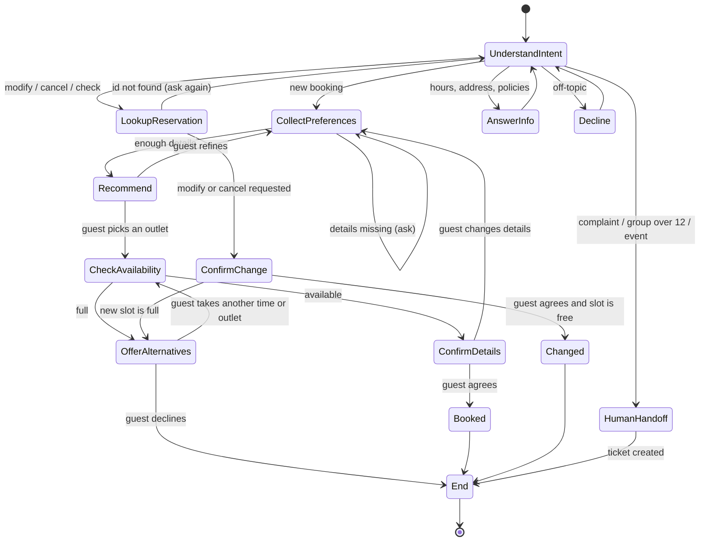

# GoodFoods Conversational Reservation Agent: Use Case

How to read this document: features are marked **Green** (built in this submission), **Yellow** (moderate, next phase) or **Red** (hard, needs new integrations). Numbers in Success Criteria and the ROI sketch are planning assumptions, stated so they can be replaced with GoodFoods' real data in a discovery call.

## Goal

Let any GoodFoods guest find the right outlet and confirm a table in a single conversation, without calling a branch, and make sure that when a branch is full the booking moves to another GoodFoods outlet instead of being lost.

## Long Term Goal

Become GoodFoods' guest-demand layer across the chain: one agent that books, reminds, re-books and remembers guests on every channel (web, WhatsApp, voice) and in the languages their guests speak, and that gives management chain-wide visibility into demand they cannot see today: unmet requests, peak-hour overflow, cuisine and area trends.

## Success Criteria

| Metric | Why it matters | Pilot target |
|---|---|---|
| Booking completion rate (confirmed bookings / conversations with booking intent) | The core job of the agent | 70% or more |
| Overflow recovery rate (bookings saved at another time or outlet when the first choice was full) | The chain-level advantage; today these guests are lost | 30% or more of "full" cases |
| No-show rate for agent-made bookings | Empty reserved tables are lost revenue | 20-30% lower than phone bookings, once reminders ship (Yellow) |
| Staff phone time saved per outlet | Frees floor staff during rush hours | 1 hour or more per outlet per day |
| Tool-call accuracy on the fixed test set (right tool, right arguments) | Leading indicator of a reliable agent; measured by the evaluation harness | 95% or more before each release |
| Human hand-off rate | The agent knows its limits | Under 10%, every hand-off with a summary |

**ROI sketch (illustrative).** With 75 outlets each taking about 40 phone reservations a day at about 2 minutes each, staff spend about 100 hours a day on the phone chain-wide. Moving half of that to the agent saves about 50 staff-hours a day. Each overflow booking recovered is a full table's revenue that would otherwise go to a competitor, so revenue protection pays for the agent before labour savings are counted.

## Use case

GoodFoods guests call individual branches to book, and when a branch is full the guest is turned away, even if another GoodFoods outlet nearby has space. The reservation agent lets a guest say what they want in plain language ("dinner for six on Friday, somewhere vegetarian-friendly near Koramangala"). It recommends outlets by cuisine, area, capacity, price, features and occasion, checks live availability, and books, modifies or cancels through tool calls, always after the guest confirms. When the first choice is full, it offers other times at that outlet or nearby GoodFoods outlets with space. Complaints and large groups go to staff with a summary. The result: fewer lost bookings, less staff time on phones, and chain-wide demand data.

## Key Steps (bot flow)

1. **Say what you want**, in your own words: party size, date, time, area, cuisine, occasion. The agent asks only for what is missing, one question at a time. "Tomorrow" and "this Friday" are understood.
2. **Get recommendations**: up to 3 outlets, each with its reason, for example "Andhra, South Indian; 0.6 km from Indiranagar; rated 4.6; free at 20:00".
3. **Pick and check**: the agent checks live availability for that outlet and time.
4. **If it is full, don't lose it**: the agent offers the nearest free times at the same outlet, or the same time at nearby GoodFoods outlets, same cuisine first.
5. **Confirm**: the agent reads back outlet, date, time, party size and name. Nothing is booked until the guest agrees.
6. **Get a reference**: a booking id such as GF7K2QXM.
7. **Change your mind**: "move my booking to 9 pm" or "cancel it" with the booking id; the change is read back and confirmed the same way. Online changes close 2 hours before the booking.
8. **Need a human?** Complaints, groups over 12 and events become a staff ticket with the conversation summary; staff call the guest back.

## State Transition Diagram

## Bot Features

| Feature | Status | Notes |
|---|---|---|
| Natural-language booking; the model decides intent, no keyword rules | Green | Tool calling over MCP; gpt-oss-20b on Groq (Groq's replacement for the retired Llama 3.1 8B) |
| Relative dates ("tomorrow", "Friday") | Green | A calendar computed in code is placed in the prompt; the model looks dates up |
| Recommendations across 75 outlets (cuisine, area, capacity, price, features, occasion) | Green | Ranked, with a reason per pick; free outlets first when a time is given |
| Live availability by date, time and party size | Green | Seat capacity, 30-minute slots, tables held 90 minutes |
| Book, look up, modify, cancel by booking id | Green | No double booking: the seat check and the write run in one locked transaction |
| Confirmation before any write | Green | Enforced in code, not only in the prompt (see README) |
| Overflow routing to another time or a nearby outlet | Green | The chain-level differentiator |
| Graceful errors: past dates, closed hours, impossible party sizes, malformed tool calls | Green | Errors return to the model as readable results so it can correct itself |
| Human hand-off with a summary | Green | Ticket stored with summary and callback number |
| Voice in the web app: speak a request, hear the reply | Green | Sarvam Saaras (speech-to-text) and Bulbul (text-to-speech) |
| Indian languages: speak in Hindi, Kannada, Tamil and more, get replies in that language | Green | Translation at the edges (Saaras, Sarvam-Translate); the agent itself stays English; replies spoken in 11 languages |
| Hand-off into GoodFoods' ticketing or CRM | Yellow | Integration with their system |
| Confirmations and reminders to cut no-shows | Yellow | SMS or WhatsApp integration |
| Guest profiles (dietary needs, past visits, occasions) | Yellow | Consent and CRM integration |
| Deposits for large groups and peak slots | Red | Payment gateway |
| WhatsApp and phone channels | Red | Channel integration and streaming speech for live calls |

- **Knowledge bases:** the outlet directory (area, address, cuisine, capacity, hours, price band, cost for two, rating, features such as parking, kid-friendly, vegetarian-friendly, wheelchair access) and booking policies (online bookings up to 12 guests, tables held 90 minutes, bookings open 60 days ahead, online changes close 2 hours before).
- **Tools:** `recommend_restaurants`, `get_restaurant_details`, `check_availability`, `make_reservation`, `get_reservation`, `modify_reservation`, `cancel_reservation`, `request_human_handoff`, served by an MCP server.
- **Languages:** English typed; spoken input in English and Indian languages, with replies translated and spoken back in 11 of them (Green).
- **Additions beyond the brief:** overflow routing, a code-enforced confirmation gate, staff hand-off tickets, voice and Indian languages, and an evaluation harness.
- **Integrations for production:** GoodFoods' table-management or POS system (replacing the demo database), SMS or WhatsApp, CRM, a payment gateway and staff ticketing.

## Scale up / Rollout Strategy

1. **Offline evaluation:** the scripted journeys in `evals/` run before every release; ship only above the tool-accuracy bar.
2. **Shadow pilot (2 weeks, 3-5 outlets):** the agent drafts bookings and staff approve each one. Measures accuracy on real requests with no risk to guests.
3. **Live pilot (4 weeks, same outlets):** the agent books directly on the website; the phone stays available. Compare completion, no-show and overflow-recovery rates with non-pilot outlets.
4. **Chain rollout:** all outlets on the web, then WhatsApp. Failed conversations are reviewed weekly and added to the test set.
5. **Expansion:** phone and WhatsApp on the existing voice layer, then the same agent for other clients.

**Vertical expansion.** The core is matching a request to limited capacity at a specific time across multiple locations. The same tools-and-agent design transfers, with a new catalogue and capacity model, to other restaurant chains and cloud-kitchen brands, salons and spas (stylist slots), clinics and diagnostic labs (doctor and test slots), sports courts and gyms, coworking meeting rooms, and hotel dining and events. Each needs only its own capacity rules and catalogue, which makes this a repeatable product rather than a one-off build.

**Potential customers.** The best first customers share GoodFoods' problem: multi-outlet casual and fine-dining chains in Indian metros, with bookings taken by phone at each branch and guests turned away at weekend peaks. Next come hotel groups running several restaurants per property, and food courts or dining destinations with many outlets under one operator. The buyer is the head of operations or the digital/CX lead; the proof they need is the pilot's overflow-recovery and completion numbers.

**Competitive advantages.**
1. **Chain-level overflow routing.** Single-restaurant booking tools cannot send a guest to a sister outlet; this turns "sorry, we're full" into a saved booking.
2. **Measured reliability.** Tool selection and argument accuracy are numbers tracked per release, not a demo impression, and writes are gated in code, so a model mistake cannot create a booking the guest did not approve.
3. **Built for India's guests.** Guests already speak to it in their own language; WhatsApp and phone are the next channels, which is where most guest conversations in India happen.

## Opportunities beyond reservations

Every conversation records what a guest wanted, not only what they booked. That makes the agent a source of data GoodFoods does not have today:

- **Unmet demand by area and hour.** Requests that end with no table, even after overflow routing, show where the chain turns guests away. That is evidence for where to add seats or open the next outlet.
- **Filling quiet slots.** Offering 6:30 instead of 8:00 moves demand into hours that would otherwise be empty, without discounting.
- **Group and event leads.** A request for 25 people is a high-value sale that today is often a missed call. Hand-off tickets turn it into a lead with a name, phone and summary for the events team.
- **Service quality signal.** Complaint tickets arrive tagged by outlet, so operations see problems by branch without waiting for review sites.
- **Guest memory (Yellow).** Repeat guests, usual party size and preferences enable a faster rebooking and targeted offers on WhatsApp.

## Stakeholders

| Who | What they need from this | Role in the rollout |
|---|---|---|
| Guests | A table in one conversation, in their language, without calling | Pilot users; their completion and drop-off rates decide go or no-go |
| Outlet managers and floor staff | Fewer phone calls in rush hours; a clear queue of hand-offs | Approve bookings during the shadow pilot; handle hand-off tickets |
| Central operations | Chain-wide view of demand, overflow and complaints | Owns the success metrics and the go-live decision |
| Marketing / CRM | Reachable guests for reminders and offers | Owner of the WhatsApp channel (Yellow/Red phase) |
| IT / table-management vendor | A stable integration with live availability | Provides the availability API: the main production dependency |

## Key Challenges

- **Small-model tool calling.** A small model sometimes picks the wrong tool or produces malformed arguments. Mitigation: tight schemas, errors fed back for self-correction, one retry for unparseable calls, a step limit, and the evaluation set to catch regressions.
- **Ambiguous requests.** "Somewhere nice this weekend": the agent must ask the fewest clarifying questions without becoming an interrogation.
- **Dates and times.** Relative dates are resolved from a calendar computed in code; times outside the 30-minute grid or opening hours are rejected with the nearest valid options.
- **Double booking.** Two guests booking the last table at once. Mitigation: seat check and write in one locked transaction.
- **Hallucinated availability.** The model must never claim a table is free without a tool result. Mitigation: prompt rules, and confirmations built only from tool output.
- **Rate limits.** The free tier allows 8,000 tokens per minute and 200,000 per day, about three model calls a minute with full context; the agent compacts tool results and trims history, and production needs a paid tier.
- **Integration with real systems.** GoodFoods' table-management system may not expose live availability cleanly: the biggest production risk.
- **Trust and hand-off.** Knowing when to stop and pass to a human, with context.
